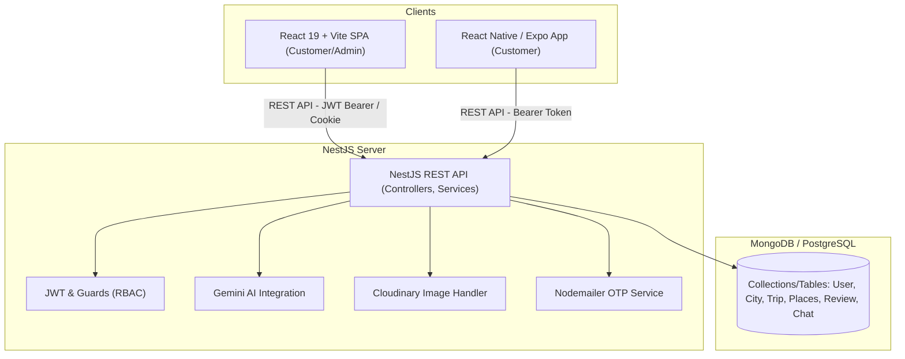

# Tài liệu 01: Giới thiệu Tổng quan & Kiến trúc Dự án TravelLako

Chào mừng các bạn Frontend Developer (Web & Mobile) tham gia phát triển dự án **TravelLako** - Hệ thống tư vấn, quản lý và tự động tối ưu hóa lịch trình du lịch thông minh.

Tài liệu này cung cấp cái nhìn tổng quan về hệ thống, kiến trúc ứng dụng và cơ chế xác thực (Authentication Flow) để bắt đầu xây dựng FE.

---

## 1. Giới thiệu Dự án
**TravelLako** là một nền tảng hỗ trợ người dùng khám phá các địa điểm du lịch, ẩm thực, giải trí và lập kế hoạch di chuyển tối ưu:
*   **Customer (Khách hàng):** Khám phá danh thắng, khách sạn, nhà hàng, quán cafe; yêu thích địa điểm; lên lịch trình chuyến đi; trò chuyện trực tiếp với trợ lý ảo AI để được đề xuất và tối ưu hóa đường đi ngắn nhất.
*   **Admin (Quản trị viên):** Quản trị danh sách người dùng, thành phố, địa điểm du lịch; xem biểu đồ thống kê tăng trưởng; import dữ liệu hàng loạt.

---

## 2. Kiến trúc Hệ thống (System Architecture)
Hệ thống được phát triển theo mô hình **Client-Server** chuẩn **Kiến trúc B: SPA + NestJS REST API**:



---

## 3. Cấu trúc thư mục dự án Web (React + Vite - SPA)

Dự án Web Frontend sử dụng **React + Vite + TypeScript (Strict Mode)** theo mô hình **Feature-based Architecture**:

```
web/
├── public/                        # Static assets (favicon.svg, icons.svg)
├── src/
│   ├── assets/                    # Ảnh, SVG, fonts toàn cục
│   ├── components/                # Components giao diện dùng chung
│   │   ├── common/                # Button, Input, Modal, Toast, Table...
│   │   ├── layout/                # Header, Footer, Sidebar
│   │   └── compound/              # Compound Components (FilterGroup, Tabs...)
│   ├── config/                    # Cấu hình tập trung (Axios, Constants)
│   │   └── axios.ts               # Axios instance (Interceptors, JWT header, Error handling)
│   ├── features/                  # Module hóa theo tính năng nghiệp vụ (Feature-driven)
│   │   ├── admin/                 # Quản trị (Dashboard, Places, Users, Reviews)
│   │   ├── auth/                  # Đăng nhập, đăng ký, xác thực OTP
│   │   ├── diary/                 # Nhật ký hành trình, ảnh chuyến đi, review
│   │   ├── places/                # Khám phá, lọc danh sách, chi tiết địa điểm
│   │   └── trips/                 # Lập kế hoạch, quản lý lịch trình, timeline
│   ├── hooks/                     # Custom Hooks dùng chung (Ít nhất 2 Generic Hooks)
│   │   ├── useDebounce.ts         # Generic hook debounce tìm kiếm
│   │   ├── usePagination.ts       # Generic hook phân trang dữ liệu
│   │   └── useDocumentTitle.ts    # Title động cho từng trang (SEO SPA)
│   ├── layouts/                   # Khung giao diện (MainLayout, AuthLayout, AdminLayout)
│   ├── routes/                    # Quản lý định tuyến React Router
│   │   ├── AppRoutes.tsx          # Code-splitting với React.lazy() & Suspense
│   │   └── ProtectedRoute.tsx     # Phân quyền RBAC (Role-based Access Control)
│   ├── services/                  # Tầng tích hợp API client theo domain
│   ├── store/                     # State toàn cục bằng Zustand (AuthStore, UIStore)
│   ├── types/                     # TypeScript types/interfaces/DTO dùng chung
│   ├── utils/                     # Tiện ích, formatters, type guards
│   ├── App.tsx                    # Component gốc
│   ├── index.css                  # Tailwind CSS directive & variables
│   └── main.tsx                   # Entry point ReactDOM
├── tests/                         # Bộ kiểm thử Vitest + React Testing Library (≥ 15 tests)
├── .env.example                   # Biến môi trường mẫu
├── index.html                     # File HTML chính (Mount root div, nạp Google Fonts)
├── package.json                   # Quản lý dependencies & scripts
├── tsconfig.json                  # Tham chiếu cấu hình TS
└── vite.config.ts                 # Cấu hình Vite & Tailwind
```

---

## 4. Luồng xác thực người dùng (Authentication Flow)

Dự án sử dụng cơ chế bảo mật **JWT (JSON Web Token)** để xác thực quyền truy cập qua giao thức REST API:

### A. Dành cho Web Frontend (React + Vite + TypeScript)
*   **Khi đăng nhập thành công (`POST /api/auth/login`):** Backend NestJS trả về accessToken (và refreshToken) hoặc ghi cookie `httpOnly`. FE lưu token an toàn và cập nhật trạng thái người dùng vào Zustand `useAuthStore`.
*   **Gửi Request từ Web:** Axios Interceptor tự động đính kèm `Bearer token` vào header `Authorization` trên mọi request:
    ```typescript
    // src/config/axios.ts
    import axios from 'axios';

    const api = axios.create({
      baseURL: import.meta.env.VITE_API_URL || 'http://localhost:5000/api',
      headers: {
        'Content-Type': 'application/json',
      },
    });

    api.interceptors.request.use((config) => {
      const token = localStorage.getItem('access_token');
      if (token && config.headers) {
        config.headers.Authorization = `Bearer ${token}`;
      }
      return config;
    });

    export default api;
    ```

*   **Bảo vệ Route với React Router (`ProtectedRoute.tsx`):**
    ```typescript
    // src/routes/ProtectedRoute.tsx
    import { Navigate, Outlet } from 'react-router-dom';
    import { useAuthStore } from '@/store/useAuthStore';

    interface ProtectedRouteProps {
      allowedRoles?: string[];
    }

    export const ProtectedRoute = ({ allowedRoles }: ProtectedRouteProps) => {
      const { user, isAuthenticated } = useAuthStore();

      if (!isAuthenticated) {
        return <Navigate to="/login" replace />;
      }

      if (allowedRoles && user && !allowedRoles.includes(user.role)) {
        return <Navigate to="/403" replace />;
      }

      return <Outlet />;
    };
    ```

### B. Dành cho Mobile App (React Native / Expo)
*   Tương tự như Web, sau khi đăng nhập thành công, Mobile App lưu JWT Token vào `expo-secure-store` và đính kèm vào Header `Authorization: Bearer <token>` trên mỗi request.

### C. Quy trình Xác thực tài khoản bằng OTP (Email Verification)
1.  Người dùng điền thông tin đăng ký (`/api/auth/register`).
2.  Backend tạo tài khoản ở trạng thái chưa kích hoạt (`isVerified: false`), gửi mã OTP 6 số qua email.
3.  FE điều hướng đến trang xác thực OTP (`/verify-otp`).
4.  Người dùng nhập OTP và FE gửi yêu cầu xác thực (`/api/auth/verify-otp`).
5.  Xác thực thành công -> Lưu JWT, cập nhật trạng thái người dùng và chuyển hướng về trang chủ (`/`).

---

## 5. Danh sách Công nghệ & Thư viện Đề xuất (Tech Stack)

### A. Dành cho Web Frontend (React + Vite + TypeScript)

#### 1. Bộ khung & Cấu trúc cơ bản
*   **React 19 & TypeScript**: Strict mode (`strict: true`), Type-safe toàn diện, Generic types, Utility types.
*   **Vite**: Build tool thế hệ mới, Hot Module Replacement (HMR) cực nhanh.
*   **React Router**: Định tuyến client-side SPA, hỗ trợ code-splitting qua `React.lazy()` và `Suspense`.
*   **Tailwind CSS**: Utility-first CSS, định nghĩa bảng màu nhận diện thương hiệu TravelLako.

#### 2. Kết nối API & Quản lý State
*   **`axios`**: HTTP Client với Request & Response Interceptors.
*   **`@tanstack/react-query`**: Quản lý server state, caching, refetching và đồng bộ dữ liệu.
*   **`zustand`**: Quản lý client global state nhẹ, gọn, tối ưu cho TypeScript.
*   **React Context**: Dùng cho state ít thay đổi (`ThemeContext`, `ToastContext`).

#### 3. Thiết kế & Hiệu ứng Giao diện (UI/UX)
*   **`lucide-react`**: Bộ icon vector sắc nét, tối giản.
*   **`framer-motion`**: Micro-interactions và page transitions mượt mà.
*   **`sonner`**: Hệ thống thông báo Toast hiện đại.

#### 4. Bản đồ & Tính năng Lập lịch trình
*   **`leaflet` & `react-leaflet`**: Hiển thị bản đồ tương tác, định vị tọa độ địa điểm du lịch.
*   **`@hello-pangea/dnd`**: Kéo thả Timeline để sắp xếp thứ tự các điểm đến trong ngày.
*   **`date-fns`**: Xử lý và định dạng ngày tháng.

#### 5. Form & Validation
*   **`react-hook-form`**: Quản lý form hiệu năng cao, giảm thiểu re-render.
*   **`zod` & `@hookform/resolvers`**: Kiểm tra tính hợp lệ của dữ liệu form với schema validation.

#### 6. Kiểm thử (Testing)
*   **`vitest`**: Test runner tích hợp sâu với Vite.
*   **`@testing-library/react` & `@testing-library/user-event`**: Kiểm thử component theo tương tác người dùng thực tế.

---

### B. Dành cho Mobile App (React Native / Expo + TypeScript)
*   **Expo & `expo-router`**: Framework và điều hướng mobile.
*   **`nativewind`**: Tailwind CSS cho React Native.
*   **`expo-secure-store`**: Lưu trữ bảo mật JWT Token.
*   **`expo-location` & `react-native-maps`**: Bản đồ và định vị GPS.
